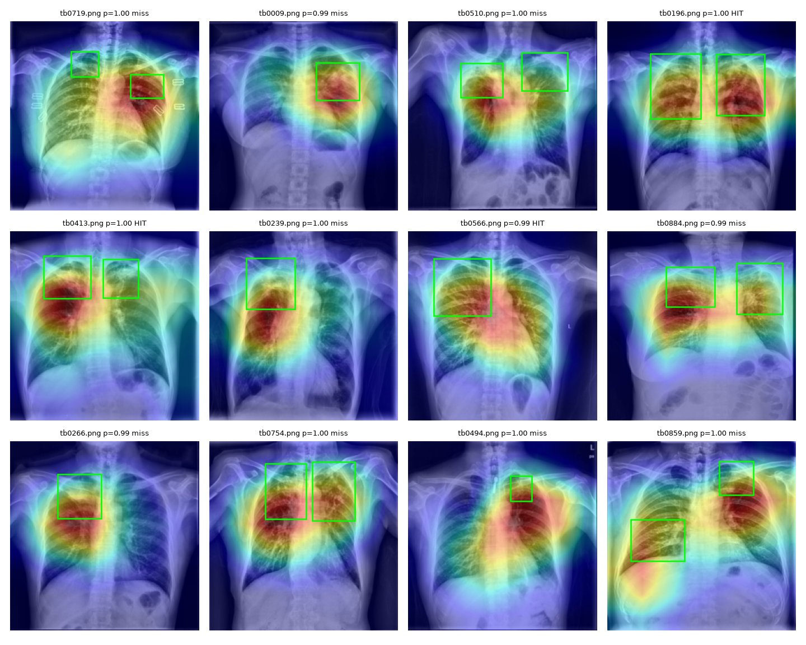
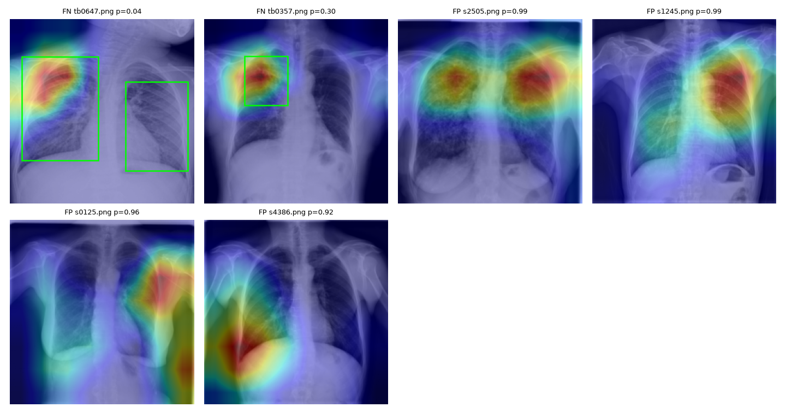

# TB chest X-ray classifier: where does it look, and does it travel?

A tuberculosis (TB vs non-TB) classifier for chest X-rays. It goes past "99% accuracy" and asks two questions:

1. **Where is the model looking?** Grad-CAM heatmaps, scored against radiologist bounding boxes.
2. **Does it still work at a different hospital?** Every model is tested on images from three hospitals it never saw during training.

> ⚠️ This is a learning project, not a diagnostic tool. Do not use it for clinical decisions.

## Key findings so far

- **The official TBX11K split leaks.** It contains 50 pixel-identical or near-identical images that appear in both train and val. All of them are from the "sick, non-TB" class. `prepare.py` removes the copies from val/test, so the test score is not inflated.
- **Near-perfect at home, close to a coin flip abroad.** The baseline ResNet18 reaches **0.997 AUC** on the TBX11K test set but only **0.547** on Shenzhen. On Shenzhen it gives healthy lungs a median TB probability of 0.98. Training longer makes this worse: external AUC is 0.71 after 1 epoch and 0.60 after 10.
- **It is not a "cheating on markers" shortcut.** On the external hospitals, the heatmaps stay on the lungs, not on text labels or image borders. What breaks is the model's idea of what a *normal* lung looks like on another scanner (domain shift).
- **CLAHE plus scanner-style augmentation helps, but only a little.** External AUC improves by **+0.058** (95% CI +0.032 to +0.085), and the heatmaps get closer to the lesions (pointing game 0.33 → 0.45). Most of the gap is still open.

## Results

AUC on the internal TBX11K test set and on each external hospital. The last two columns measure how well Grad-CAM matches radiologist boxes on 100 test TB images.

| Run | Backbone | CLAHE + strong aug | Test | External | DA/DB | Montgomery | Shenzhen | Pointing game | CAM energy in box |
|---|---|---|---|---|---|---|---|---|---|
| `baseline` | ResNet18 (ImageNet) | | **0.997** | 0.604 | 0.658 | 0.622 | 0.547 | 0.33 | 0.191 |
| `A_clahe_aug` | ResNet18 (ImageNet) | ✓ | 0.992 | **0.662** | **0.716** | 0.650 | **0.623** | **0.45** | 0.198 |
| `B_xrv` | DenseNet121 (torchxrayvision) | | *running* | | | | | | |
| `AB_xrv_clahe_aug` | DenseNet121 (torchxrayvision) | ✓ | *running* | | | | | | |

**Pointing game:** how often the hottest Grad-CAM pixel falls inside a radiologist box. Random guessing scores ≈ 0.106, the average fraction of the image the boxes cover.

**Is the improvement real?** Paired, label-stratified bootstrap (1000 resamples, same images for both runs), Δ AUC vs `baseline`:

| Run | External | DA/DB | Montgomery | Shenzhen |
|---|---|---|---|---|
| `A_clahe_aug` | **+0.058** [+0.032, +0.085] | +0.057 [−0.004, +0.114] | +0.028 [−0.085, +0.128] | **+0.076** [+0.027, +0.124] |

Bold means the 95% interval excludes 0. Each run uses a single training seed, so these intervals cover test-set sampling noise only, not training variance.

### What the heatmaps show

TBX11K test TB images. Green boxes are radiologist annotations; `HIT` means the hottest pixel is inside a box (`A_clahe_aug`):



Mistakes (`baseline`). In the first image, the model's attention sits right on the lesion, yet it predicts p = 0.04. Most false positives come from the "sick, non-TB" class:



## Data

| Split | Source | Images | TB |
|---|---|---|---|
| train | TBX11K `TBX11K_train` | 6600 | 600 |
| val | Half of TBX11K `TBX11K_val` (stratified), duplicates removed | 878 | 100 |
| test | Other half, duplicates removed | 872 | 100 |
| external | Montgomery (USA), Shenzhen (China), DA/DB (India), from TBX11K `imgs/extra` | 576 | 272 |

Non-TB = healthy + "sick but non-TB". TBX11K's official test labels are not public (the test set is used for an online challenge), so val is split into val and test. The external images are never used for training or for picking the decision threshold. The threshold is chosen on val (Youden's J) and then kept fixed.

## Run it

```bash
uv sync
uv run python prepare.py         # downloads TBX11K (~3 GB) via kagglehub, resizes to 256px, removes duplicates
./experiments.sh                 # trains + Grad-CAM for each experiment into runs/<name>/
uv run python compare.py         # results table + bootstrap CIs
```

Single experiment, with live progress:

```bash
uv run python train.py --name my_run --model xrv-densenet --clahe --strong-aug
uv run python gradcam.py --name my_run
```

**On Colab:** `uv run python make_colab.py "<name> <train args>"` writes a self-contained notebook, `colab_<name>.ipynb`, that embeds the current scripts. The notebook checks that its splits match the local ones (hash of each split's file list), trains on a T4, and downloads `runs_<name>.zip`.

## Hardware notes

These experiments were developed on a **MacBook Air M5 with 16 GB** (PyTorch MPS):

- **Small memory footprint:** all images are pre-resized to 256px and kept in RAM (~550 MB). Data loading uses `num_workers=0`, because macOS worker processes would each copy the dataset.
- **The GPU is the bottleneck, not the CPU:** augmentation takes ~35 ms per batch, while the ResNet18 forward + backward pass takes ~330 ms. Running two trainings in parallel on one GPU halves the speed of each.
- **The fanless chip throttles:** epoch time grows from ~64 s to ~100 s over a 10-epoch run.
- **Speed:** ResNet18 runs at ~1 min/epoch, DenseNet121 at ~2 min/epoch. The code also runs on CUDA (`cuda → mps → cpu`).

## Files

| File | Purpose |
|---|---|
| `prepare.py` | Download, label, split, deduplicate, and resize; extract bounding boxes |
| `train.py` | Fine-tuning, val-chosen threshold, test/external predictions |
| `gradcam.py` | Heatmaps, pointing game, error and external galleries |
| `compare.py` | Cross-run table and paired bootstrap CIs |
| `experiments.sh` | Experiment queue |
| `make_colab.py` | Generates Colab notebooks from the local scripts |

## Next steps

- [ ] Fill in `B_xrv` and `AB_xrv_clahe_aug`
- [ ] Lung segmentation crop (torchxrayvision PSPNet) so the model only sees the lungs
- [ ] Multi-site training: add `extra/train` to training, test on `extra/val`
- [ ] Repeat runs with several seeds to measure training variance
- [ ] Gradio demo: upload an X-ray, get a prediction and a heatmap

## Citations

- TBX11K: Liu et al., *Rethinking Computer-Aided Tuberculosis Diagnosis*, CVPR 2020
- Montgomery & Shenzhen: Jaeger et al., *Quantitative Imaging in Medicine and Surgery* 4(6), 2014
- DA & DB: Chauhan et al., *PLoS ONE* 9(11), 2014
- torchxrayvision: Cohen et al., *TorchXRayVision: A library of chest X-ray datasets and models*, MIDL 2022
